# AP2 · 三维层级场景：太阳系

## 运行

浏览器需支持 WebGL 2.0。ES Module 不能用 `file://` 打开。

```bash
python -m http.server 8000
# 打开 http://localhost:8000
```

教材配套库：`Common/MV.js`、`initShaders.js`、`webgl-utils.js`（Angel & Shreiner, *Interactive Computer Graphics*）。

天体参数（半径、轨道半径、公转/自转周期、倾角）全部写在 `js/config.js`。

## 交互

| 操作 | 效果 |
|---|---|
| 左键拖拽 | **偏航 / 俯仰轨道相机**：水平拖 = 环绕，垂直拖 = 俯仰（向下拖 = 视角抬高，方向恒定，pitch 限 ±85°，不翻转） |
| **W / A / S / D** | 沿当前视线自由飞行（方向随相机朝向，对角归一化不加速），`Shift` 加速 |
| 滚轮 | 以当前观察目标为基点缩放 |
| **单击天体（或名称标签）** | 相机平滑飞近聚焦，注视点跟随其公转；金色呼吸环 + 边缘描光高亮 |
| **单击空白处** | 平滑回到全景视角 |
| 悬停天体 | 光标变手型 + 蓝色描光 + 标签变亮（聚焦时其余标签淡出） |
| 公转 / 自转 / 轴倾角滑条 | 仅自定义演示模式可用（真实模式下禁用，避免与真实天文状态混用） |
| 轨道线开关 / 名称标签开关 | 只控制显示，不影响任何位置或运动计算 |
| 暂停时间 `P` | 冻结模拟时间（真实模式冻结日期推进，演示模式冻结仿真年） |
| `O` | 透视 ↔ 正交，同一相机、同一画面 |
| `空格` | 暂停 / 继续环绕漫游 |
| `C` 或「继续漫游」 | 从手动视角交还漫游 |
| 日食 / 月食演示 | 自动对齐并冻结一切运动；空间视角 / 地面视角切换；`Esc` 或「返回太阳系」恢复原状态 |

## 时间与天文模式（V3 新增）

- **真实天文模式（默认）**：以 `sim.date`（UTC，可输入任意时刻）为唯一时间源。行星位置来自 `js/astro.js`
  的 JPL 近似轨道要素（1800–2050 有效，非精确星历）；地球自转相位由**太阳直射点经度**决定；地轴倾角绕固定世界轴施加，
  因此有真实季节与晨昏线。面板实时显示：UTC 时刻、直射点经纬度、晨昏线–赤道两个交点、直射点当地太阳时。
- **自定义演示模式**：时间按仿真年推进，公转 / 自转 / 倾角滑条可调；界面明确标注「为展示参数，不代表真实天文状态」。
- 两种模式共用同一套层级变换与渲染管线；切换模式不会破坏太阳–行星–月球的父子关系。

## 太阳渲染与日月食演示（V3 新增）

- **太阳**：日面 = 纹理 × 3D 噪声颗粒 × 轻微临边因子；日冕 = **单个面向相机的 billboard**，径向连续衰减 +
  角度向 fBm 丝状结构，无分层圆环（旧版的多圈光晕已删除）。径向亮度剖面实测单调衰减。
- **日食**：冻结全部运动后，围绕地月区域取景；解析绘制月球本影锥（9% 加色）、半影锥（5% 加色），
  并用**乘色混合**把本影 / 半影真正压暗到地球表面。地面视角把相机放到阴影落点附近，同时小窗按真实角尺寸绘制日面/月面遮挡。
- **月食**：绘制地球本影锥 / 半影锥，月球按「到地影轴距离 vs 本影半径」被乘色压暗；地面视角从地球夜面朝月球观察。
- 进入演示时保存原 `mode/date/time/rate/paused/projection/相机位姿`，退出时恢复。

> 视觉与交互借鉴自优秀作品 [solar-system-atlas.pages.dev](https://solar-system-atlas.pages.dev/)（暗色 + 强调色体系、悬停/选中/淡出标签系统、点击聚焦、太阳光晕、暗角与胶片颗粒）。完整分析、迁移矩阵与作业符合性审查见 [docs/analysis.md](docs/analysis.md)；V3 取证与工程报告见 [docs/evidence-v3.md](docs/evidence-v3.md)、[docs/v3-report.md](docs/v3-report.md)。

## 层级结构（变换嵌套树）

列向量、右侧先作用。地球必须**先转后挂**：局部先做轴倾角，再乘公转轨道变换。月球只挂在地球的**轨道节点**上，不继承地球自转和黄赤交角。

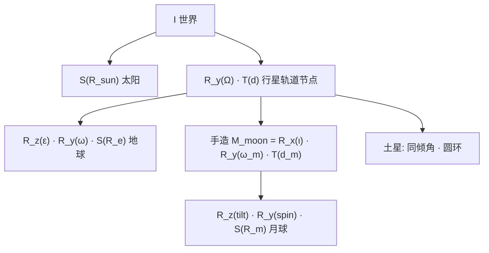

地球完整模型矩阵：

\[
M_{\text{earth}}=R_y(\Omega)\,T(d)\,R_z(\varepsilon)\,R_y(\omega)\,S(R_e)
\]

- \(R_y(\omega)\) 先让地球绕自身 \(Y\) 自转；
- \(R_z(\varepsilon)\) 再把自转轴扳到 \(23.5^\circ\)（滑条可改 \(\varepsilon\)）；
- 最后才是公转 \(T(d)\) 与 \(R_y(\Omega)\)。

若写成 \(R_y(\omega)\,R_z(\varepsilon)\)，倾角会跟着自转扫一圈，轴就立不住。这就是题目说的「变换顺序决定结构」。

## 手造矩阵：月球轨道面倾角

位置：`js/scene.js` 的 `moonOrbitMatrix`。不用任何「公转+倾角一次完成」的封装，只用 `MV.js` 的 `rotate`、`translate`，再 `mult`：

```javascript
const Rx = rotate(ι, vec3(1, 0, 0)); // 轨道面相对黄道倾 5.145°
const Ry = rotate(ω, vec3(0, 1, 0)); // 绕地球公转
const T  = translate(d, 0, 0);       // 先放到 x 轴上的轨道半径
return mult(mult(Rx, Ry), T);        // M = R_x(ι) R_y(ω) T(d)
```

对应教材 Ch4 的复合变换（列向量 \(Mv\)，右乘先作用）：

\[
T(d)=\begin{bmatrix}1&0&0&d\\0&1&0&0\\0&0&1&0\\0&0&0&1\end{bmatrix},\quad
R_y(\omega)=\begin{bmatrix}\cos\omega&0&\sin\omega&0\\0&1&0&0\\-\sin\omega&0&\cos\omega&0\\0&0&0&1\end{bmatrix}
\]

\[
R_x(\iota)=\begin{bmatrix}1&0&0&0\\0&\cos\iota&-\sin\iota&0\\0&\sin\iota&\cos\iota&0\\0&0&0&1\end{bmatrix}
\]

几何意义：月球先出现在地球局部 \(x\) 轴上，在黄道面内转起来，再把整个轨道面绕 \(x\) 抬离黄道。月球公转因此不跟着地球自转轴走。

## 表面纹理与 `UNPACK_FLIP_Y_WEBGL`

太阳、地球、月球（以及其它行星）都走 `gl.texImage2D` + `aTexCoord`。球体 UV：\(u=\lambda/2\pi\)，\(v=1-\varphi/\pi\)，\(\varphi=0\) 在北极，所以 \(v=1\) 对应图像上边。

WebGL 默认把图像**第 0 行**对应 \(t=0\)，而 \(t=0\) 在网格里是**底边**。经纬贴图文件的第 0 行却是北极。若不翻转，北极会采到南极一带，地球看起来上下颠倒。

上传前打开 `gl.pixelStorei(gl.UNPACK_FLIP_Y_WEBGL, true)`，把图像行倒过来再进 GPU，北极对 \(v=1\)。`TEXTURE_WRAP_S` 用 `REPEAT` 接经线接缝，`WRAP_T` 用 `CLAMP_TO_EDGE` 避免极点缝。

位图由 `tools/make_textures.py` 生成，放在 `textures/`。

## 透视 / 正交

`O` 切换。两种投影共用同一个 `lookAt` 相机。正交的上下界按「到注视点的距离 × tan(fovy/2)」来取，使焦平面附近的物体和透视差不多大，差别只来自投影本身：

- **透视**：近大远小；圆形轨道在画面上变成椭圆，径向有灭点感。
- **正交**：平行线保持平行，远近同样大；外侧行星不会变小，轨道更像真圆。

同场景、同相机、同仿真时刻的对比（仅投影不同，`O` 一键切换）：

| 透视 | 正交 |
|---|---|
| 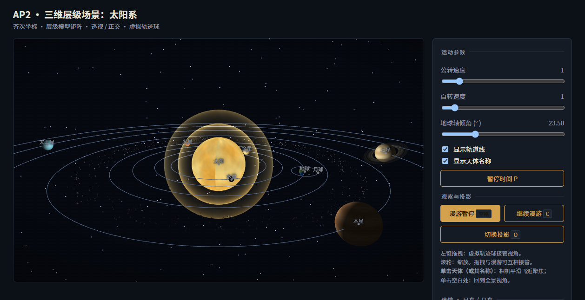 | 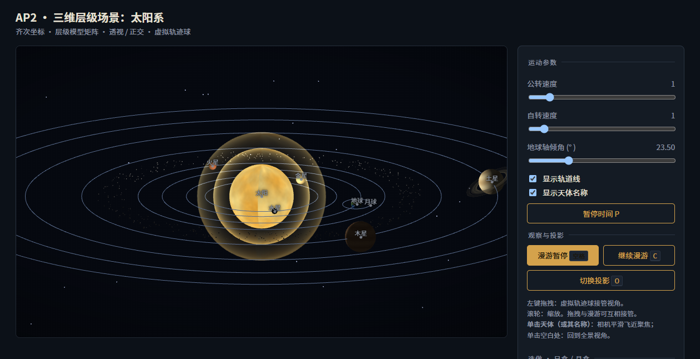 |

注意透视图中最外侧海王星轨道与内侧水星轨道大小差明显、轨道呈椭圆；正交图中各轨道接近同心真圆、远近行星大小一致。

## 相机漫游

`js/camera.js` 里有一条闭环关键帧路径（四个方位 + 回到起点），相邻帧用 smoothstep 插值，约 18 秒绕一周。`空格` 只停漫游，不停行星。左键拖拽会把模式切到交互；再按空格或 `C` 交还漫游。

10 秒漫游录屏（截取自同一关键帧路径前 10 秒）：

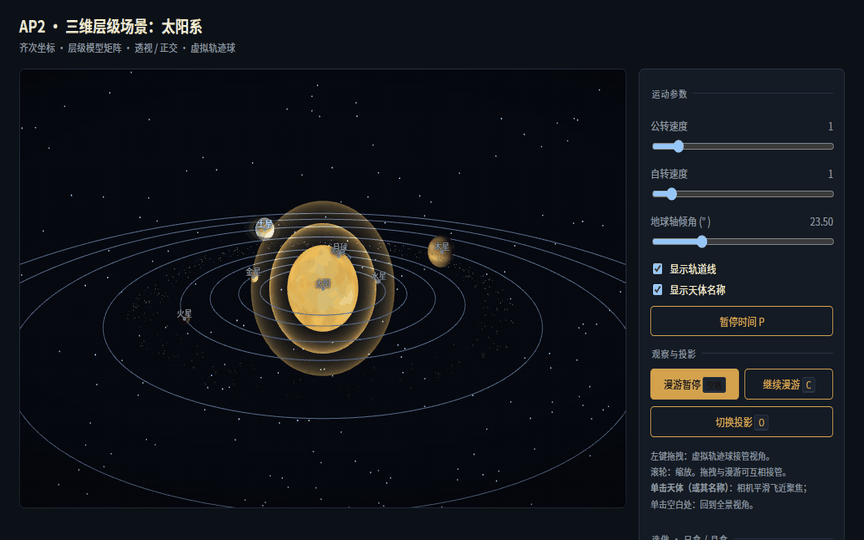

## 选做

- **E1** 八大行星 + 土星环 + 火星–木星间小行星带（`ASTEROID_BELT`）。
- **E2** 日食 / 月食：一键对齐日–地–月并切视点。太阳放在原点作点光，Lambert 着色；日食时月球挡在太阳与地球之间（几何遮挡，`uShadow` 压暗地球），月食时月球落入地球影子（`uShadow` 压暗月球）。这不是阴影贴图（那是 AP3），只是用对齐 + 本影系数说明光沿直线走、遮挡物投下影子。

  实现细节：

  - **对齐**：日食把仿真时间放到月球公转半周期（rev=180°，月球在向日侧），月食放到 rev=0（背日侧），随后**冻结时间**、相机每帧跟随天体，画面稳定可观察；
  - **日食相机**：把相机放在地–日连线上，解 `Rmoon/(Dmoon-d) = 0.88·Rsun/(Dearth-d)` 取离地心距离 `d`，使月球视直径约为太阳的 88%——呈现**环食「火环」**（无日冕模型时比全食更直观）；
  - **月食相机**：相机在地月之间略偏一侧，同框看到被本影压暗的月球与地球的昼面边缘；
  - 进入日/月食视点时强制切到透视投影——正交下月球只剩几个像素，看不出遮挡。

  | 日食（火环 + 月球夜面） | 月食（本影压暗的月球） |
  |---|---|
  | 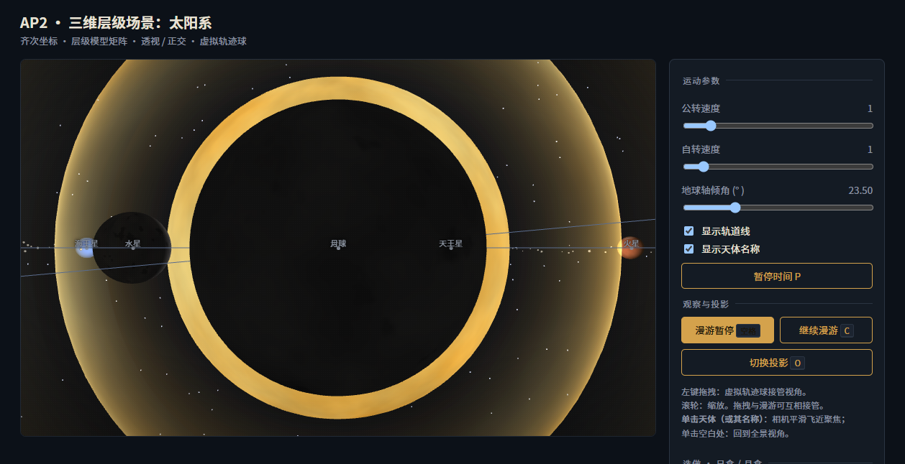 | 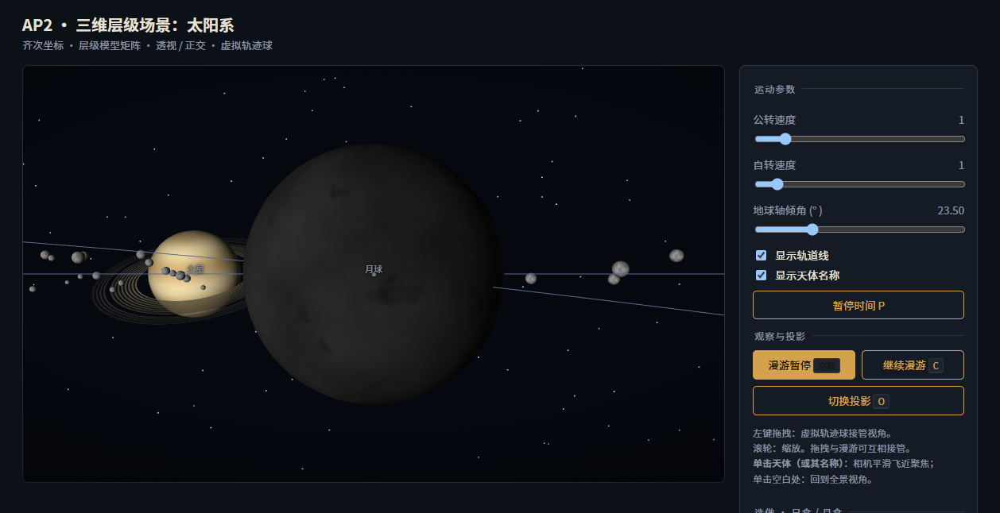 |

- **E3** 虚拟轨迹球：屏幕点投到半球，两次向量叉积为轴、点积为角，左乘到观察旋转上（教材 Virtual Trackball）。

## 演示用 URL 参数（截图 / 录屏可复现）

不参与正常交互，仅供脚本与演示：

| 参数 | 作用 |
|---|---|
| `?proj=ortho` | 初始用正交投影 |
| `?cam=0.28` | 漫游路径跳到 28% 处并套用该关键帧位姿 |
| `?pause=1` | 漫游不自动播放 |
| `?sim=0.5` | 演示模式仿真时间设为 0.5 年 |
| `?freeze=1` | 冻结模拟时间（天体不动） |
| `?mode=real` / `?mode=demo` | 初始模式（真实天文 / 自定义演示） |
| `?date=2026-10-22T12:00Z` | 真实模式初始时刻（UTC） |
| `?rate=3600` | 真实模式时间倍率（模拟秒 / 真实秒） |
| `?eclipse=solar` / `?eclipse=lunar` | 直接进入日食 / 月食演示 |

## 文件

```
index.html          着色器（日面/日冕/阴影） + 面板 + 标签/暗角/颗粒叠层
js/config.js        天体表（含真实平均日心距 orbitAU；尺度说明见文件头）
js/astro.js         天文计算：JPL 近似轨道要素、GMST、直射点、晨昏线、月球
js/geometry.js      球 / 轨道 / 环 / 星空 / 小行星 / billboard quad / 阴影锥
js/scene.js         矩阵栈 + 手造月球矩阵 + 双模式时间模型 + 日食月食阴影几何
js/camera.js        偏航俯仰轨道相机 + WASD 飞行 + 聚焦 / 日食视点
js/groundview.js    地面观测 2D 绘制组件
js/texture.js       texImage2D + UNPACK_FLIP_Y_WEBGL
js/ui.js            参数面板绑定（含暂停时间 / 标签开关）
js/main.js          渲染循环 + 拾取聚焦 + 标签 + 日食阴影/地面视角 + 演示参数
css/style.css       布局 + 标签 + 暗角颗粒 + 控件样式
Common/             教材工具库（MV.js / initShaders / webgl-utils）
textures/           位图（tools/make_textures.py 生成）
screenshots/        验收截图（v3-*.png）、参考站取证（ref-*.png）、漫游 GIF
docs/               analysis / evidence-v3 / v3-report / 发布指南
tools/              纹理生成、截图采集、GIF 合成、三套自测与整页验收脚本
```

### 验收截图（V3，实际运行截取）

| 视图 | 文件 |
|---|---|
| 默认全景（真实天文模式） | 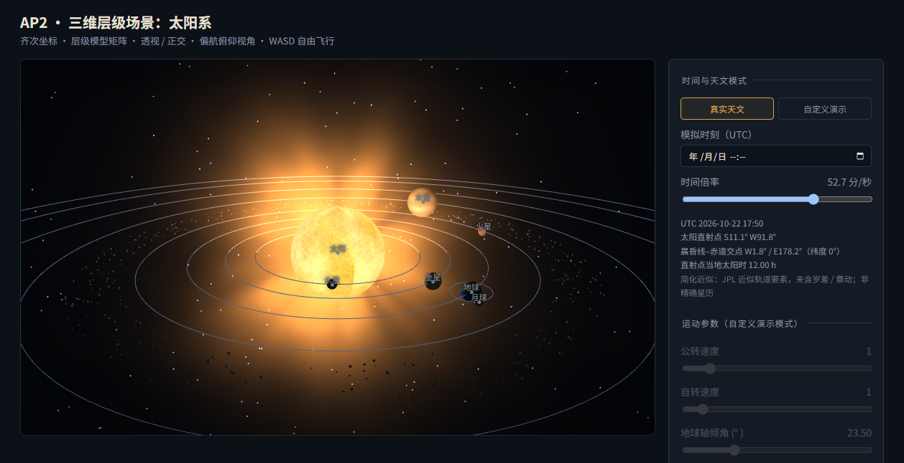 |
| 太阳特写（无分层光晕） | 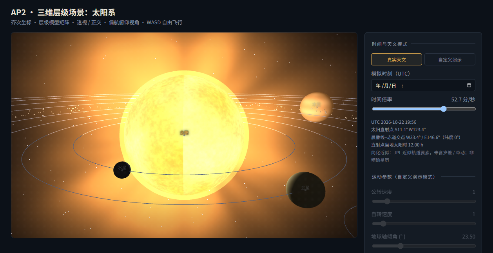 |
| 地球晨昏线 | 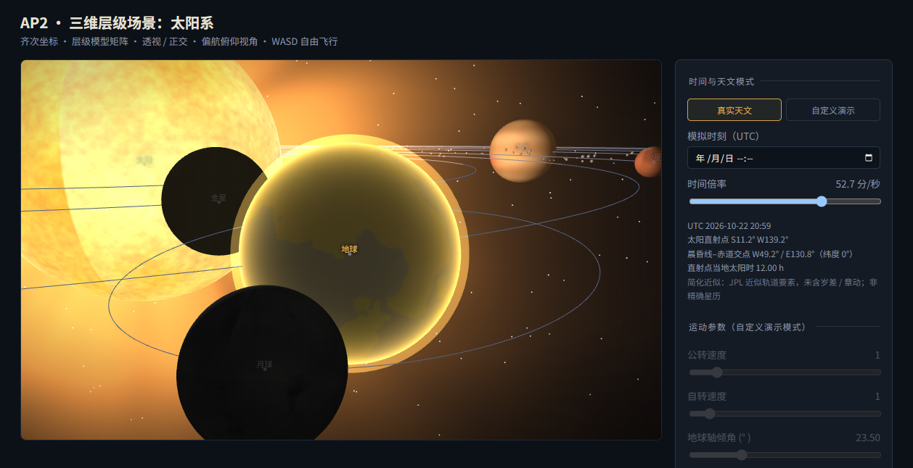 |
| 日食空间演示 | 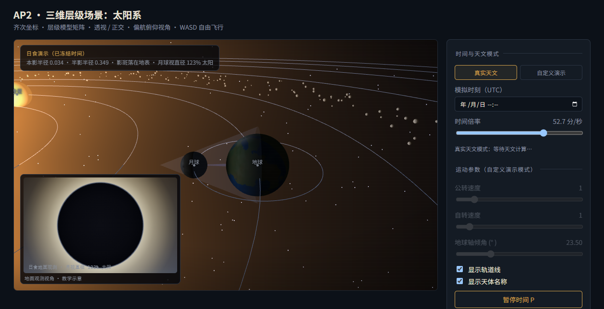 |
| 日食地面视角 | 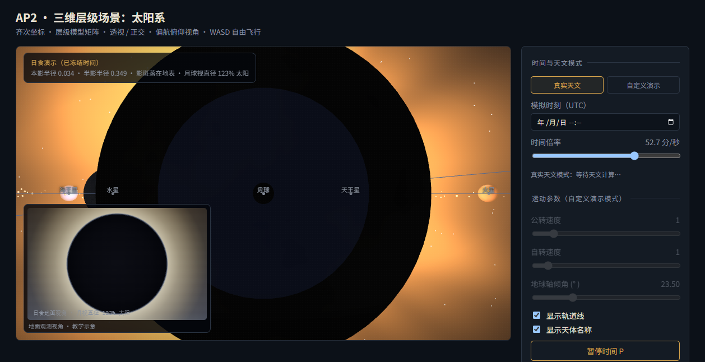 |
| 月食空间演示 | 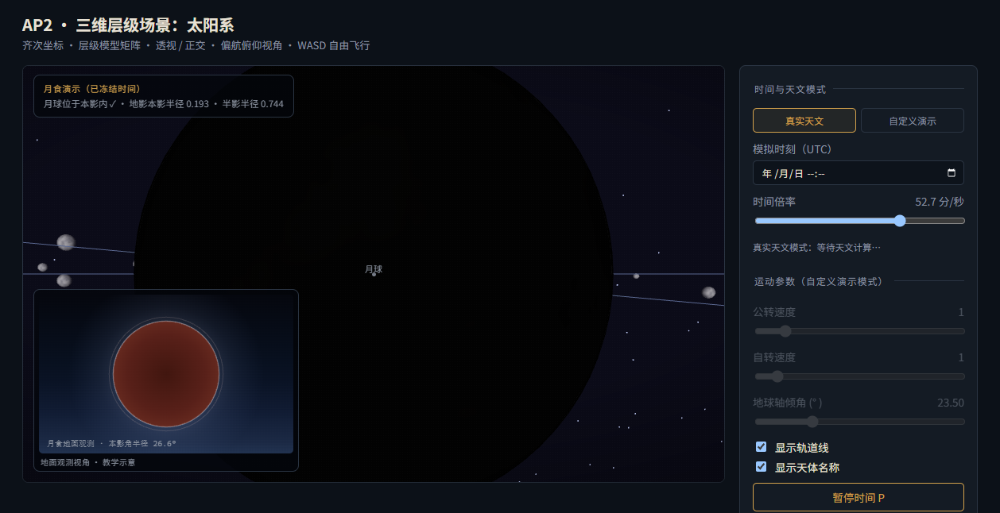 |
| 月食地面视角 |  |
| 拖拽 / WASD 后视角 | 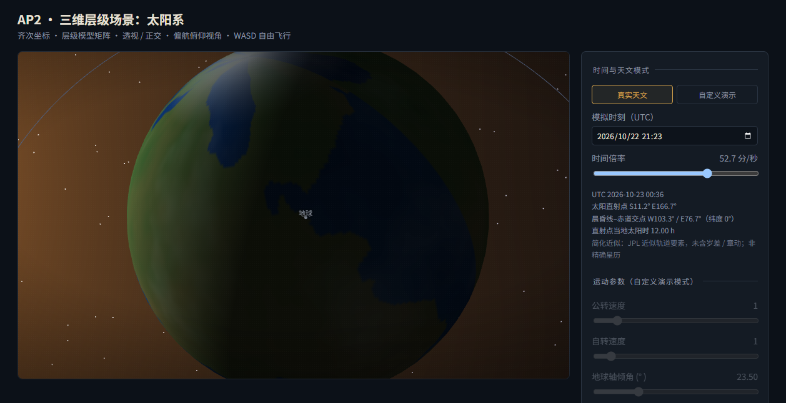 |

### 聚焦特写（点击土星后）

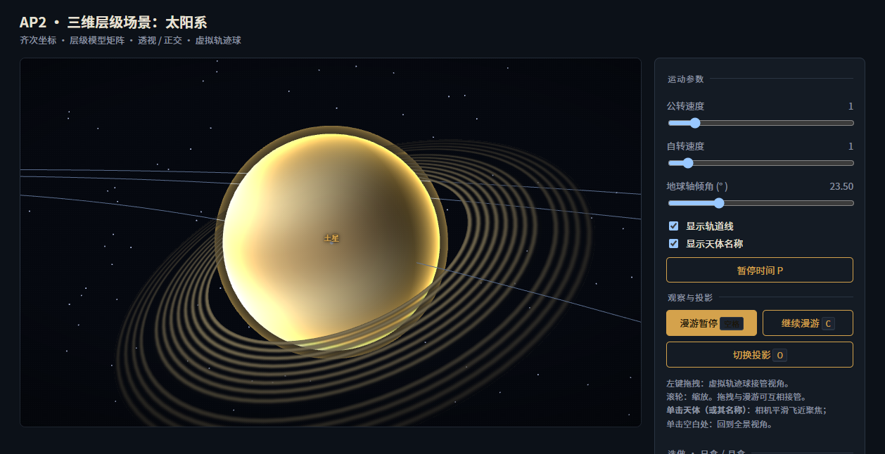
